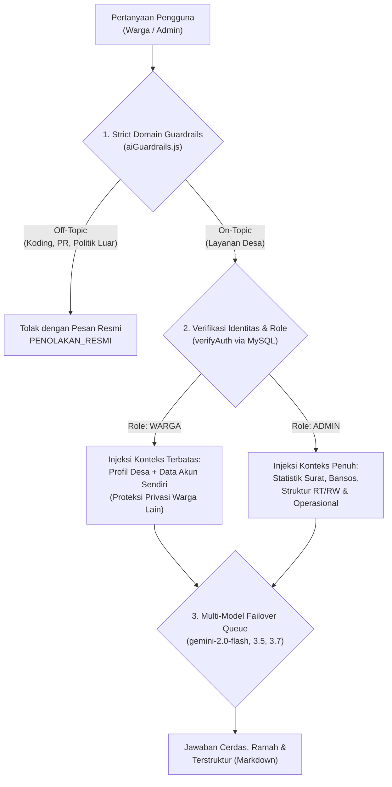

# 🏛️ SIWARGA — SVARA (Smart Village Virtual Assistant)

**Sistem Informasi Pelayanan Administrasi Desa Terpadu & Asisten Virtual Publik Berbasis AI**  
*Studi Kasus: Kantor Kuwu / Pemerintah Desa Mertapada Wetan, Kecamatan Astanajapura, Kabupaten Cirebon*

[](https://github.com/alvinjanuar05/proyek-rpl-siwarga/actions/workflows/ci.yml)


---

## 👨‍💻 Identitas Mahasiswa & Informasi Akademik

| Keterangan | Detail |
| :--- | :--- |
| **Nama Mahasiswa** | Muhammad Alvin Januar |
| **NIM** | 41257125 |
| **Program Studi** | Teknik Informatika — STMIK IKMI Cirebon |
| **Mata Kuliah** | Rekayasa Perangkat Lunak (`TIKB2503021`) |
| **Jenis Tugas** | Proyek Akhir Mandiri (Berbasis Rubrik OBE) |
| **Tema Proyek** | *Smart Government & E-Village Public Service Automation* |
| **Lokasi Studi Kasus** | Pemerintah Desa Mertapada Wetan, Kec. Astanajapura, Kab. Cirebon |
| **Repositori GitHub** | [https://github.com/alvinjanuar05-sudo/proyek-rpl-siwarga](https://github.com/alvinjanuar05-sudo/proyek-rpl-siwarga) |

---

## 🎥 Video Presentasi & Demonstrasi Proyek

Sesuai ketentuan rubrik penilaian Proyek Akhir Mandiri Rekayasa Perangkat Lunak (OBE), berikut adalah tautan dokumentasi video presentasi dan demonstrasi teknis:

**Tautan pada video penyelesaian project, saya jadikan satu video berikut LINKNYA :**

🔗 *[https://youtu.be/0C85wFq4VPs?si=6u72QEeVCSKanfhk]*  


---

## 📖 Deskripsi Aplikasi

**SIWARGA** (*Sistem Informasi Warga*) yang terintegrasi dengan **SVARA** (*Smart Village Virtual Assistant*) adalah platform transformasi digital pelayanan publik desa modern berbasis web. Dirancang khusus untuk memangkas birokrasi berbelit, mencegah pungutan liar, serta mewujudkan tata kelola desa yang transparan, akuntabel, dan inklusif.

Aplikasi ini mengintegrasikan seluruh siklus administrasi desa: mulai dari penerbitan surat resmi otomatis berformat Microsoft Word (`.docx`), tata kelola Bantuan Sosial (Bansos) & DTKS tervalidasi kamera QR Code anti-*double disbursement*, kanal aspirasi dan pengaduan infrastruktur lingkungan, direktori aparatur dan kewilayahan RW/RT, hingga pusat informasi 24/7 yang dipandu oleh asisten kecerdasan buatan cerdas **SVARA AI**.

---

## ✨ Fitur Lengkap Berdasarkan Peran (Role-Based Access Control)

### 1. Publik / Tamu (`GUEST`) — Akses Tanpa Login
* **Portal Beranda Modern Editorial Bento:** Memuat profil Desa Mertapada Wetan, visi-misi, jam operasional, dan nilai transformasi digital.
* **Pengecekan NIK Bansos Terbuka (*Open NIK Check*):** Pengecekan mandiri status kepesertaan DTKS dan jadwal gelombang pencairan hanya dengan memasukkan 16 digit NIK (nama otomatis disensor demi privasi).
* **Direktori Kewilayahan RW/RT & Pamong:** Menampilkan struktur hierarki RW dan RT, nama ketua, serta kontak resmi wilayah.
* **Pusat Informasi & Panduan Pelayanan:** Akses informasi persyaratan administrasi kependudukan dan panduan layanan publik desa.
* **Registrasi Akun Mandiri:** Pendaftaran akun warga baru secara online yang langsung masuk ke antrean verifikasi Admin Desa.

### 2. Warga Desa Terverifikasi (`WARGA`)
* **Asisten Virtual SVARA AI 24/7:** Konsultasi interaktif seputar regulasi desa, persyaratan surat, dan pelacakan status tiket milik sendiri.
* **Layanan Surat Digital Dinamis (24+ Templat):** Pengajuan surat online (SKTM, SKU, Domisili, Kematian, Kelahiran, Penghasilan, dll.) dengan input otomatis dan tanda terima nomor tiket unik (`SRT-<timestamp>`).
* **Notifikasi Email & Lonceng Real-Time:** Penerimaan email tanda terima otomatis serta pemberitahuan status permohonan secara *real-time*.
* **Usulan Mandiri Bansos & DTKS (5 Berkas Foto):** Formulir usulan bantuan sosial mandiri dengan formulir data ekonomi keluarga dan unggahan 5 berkas foto kompresi Base64 (KTP, KK, Tampak Depan Rumah, Tampak Dalam/Dapur, SKTM) terlindung sanitasi anti-XSS.
* **Klaim E-Tiket QR Bansos:** Pengunduhan tiket digital berkode QR unik (`TK-BNS-*` & `QR-BNS-*`) untuk dibawa ke balai desa saat jadwal pencairan.
* **Layanan Aspirasi & Pengaduan Warga:** Penyampaian laporan kerusakan fasilitas umum atau keluhan lingkungan berbasis wilayah RW dengan pemantauan status tindak lanjut.
* **Manajemen Keamanan Akun:** Pembaruan profil, ganti kata sandi terenkripsi `bcryptjs`, pelacakan riwayat sesi perangkat aktif (`user_sessions`), dan fitur *Global Logout*.

### 3. Administrator Desa (`ADMIN_DESA`) — Kantor Kuwu
* **Verifikasi Kependudukan:** Persetujuan atau penolakan pendaftaran akun warga baru.
* **Penerbitan Surat Otomatis (.docx Generator):** Verifikasi permohonan surat dan pencetakan instan ke dokumen resmi Microsoft Word (`.docx`) siap stempel menggunakan mesin `docxtemplater` dan `pizzip` lengkap dengan nomor registrasi keluar desa.
* **Manajemen Bansos & Kuota Harian (FIFO Batching):** Pengelolaan master data penerima bantuan, impor massal CSV/Excel, dan alokasi gelombang pencairan harian (*First-In First-Out*) dengan email blast jadwal otomatis.
* **Pemindai Kamera QR Pencairan Lapangan:** Pemindaian QR Code warga secara *real-time* via kamera laptop/handphone petugas yang dilindungi oleh **Atomic Conditional Update** di database untuk mencegah pencairan ganda (*double claim* akibat *race condition*).
* **Tata Kelola Wilayah & Pamong:** Pengelolaan data struktur pengurus RW/RT dan direktori aparatur/perangkat desa.
* **Publikasi Warta & Pengumuman Desa:** Pembuatan dan penyiaran pengumuman resmi berkategori kepada masyarakat.
* **SVARA AI Mode Operator:** Konsultasi asisten AI dengan akses data rekapitulasi operasional dan statistik desa secara komprehensif.

### 4. Super Administrator Pusat (`SUPER_ADMIN`)
* **Kontrol Konfigurasi AI Terpusat:** Pengaturan Kunci API Google Gemini dan penentuan model LLM default server secara dinamis tanpa perlu deploy ulang kode (`ai_config`).
* **Audit Trail & Keamanan Sistem:** Pemantauan log aktivitas seluruh pengguna (`activity_logs`), monitoring IP address, dan jenis peramban/perangkat.
* **Manajemen Otoritas Akun:** Aktivasi, penonaktifan, atau pembekuan akun pengguna yang bermasalah.
* **Statistik Agregat Wilayah:** Pemantauan metrik pelayanan publik desa secara terpadu.

---

## 🤖 Arsitektur & Integrasi SVARA AI

Kecerdasan buatan pada platform SIWARGA dibangun menggunakan **Google Gemini API** (`gemini-2.0-flash`) yang dikembangkan dengan pendekatan **Role-Aware Retrieval-Augmented Generation (RAG)**:



1. **Strict Domain Guardrails (`siwarga-backend/constants/aiGuardrails.js`):**  
   Menerapkan filter regex komprehensif untuk menolak pertanyaan di luar ruang lingkup desa (seperti tugas koding/pemrograman, pekerjaan rumah matematika, karya sastra umum, resep masakan, horoskop, dan politik global) dengan pesan resmi desa.
2. **Isolasi Konteks Data Berbasis Role (*Role-Aware Context Isolation*):**  
   - **Mode Warga:** Konteks prompt diisolasi ketat hanya pada informasi publik desa dan transaksi milik NIK warga yang login. AI dilarang keras membocorkan NIK, nama, atau berkas milik warga lain.
   - **Mode Admin:** Diberikan akses agregasi data rekapitulasi surat pending, statistik aspirasi, dan data kepengurusan wilayah.
3. **Multi-Model Failover Queue (Resilience):**  
   Jika model utama mengalami *rate limit* (HTTP 429) atau gangguan jaringan, backend secara otomatis beralih (*fallback*) ke antrean model alternatif secara berurutan tanpa memutus sesi pengguna.

---

## 🛠️ Tech Stack & Arsitektur Sistem

Proyek ini menerapkan arsitektur **Decoupled Monorepo** yang memisahkan aplikasi presentasi SPA (*Single Page Application*) dengan API penyedia data (*RESTful API*):

| Komponen | Teknologi | Keterangan |
| :--- | :--- | :--- |
| **Frontend Framework** | React 19.2 + TypeScript 6.0 | Antarmuka interaktif, pengetikan tipe data ketat, dan performa tinggi. |
| **Build Tool & Bundler** | Vite 8.2 | Hot Module Replacement (HMR) kilat dan hasil kompilasi optimal. |
| **Styling & UI Design** | Tailwind CSS 4.3 + Lucide Icons | Desain responsif bergaya Modern Editorial Bento. |
| **Backend Runtime** | Node.js v20+ (CommonJS) | Lingkungan eksekusi asynchronous berkinerja tinggi. |
| **Web Framework** | Express.js 5.2 | RESTful API modular (Routes, Controllers, Middlewares, Services). |
| **Basis Data** | MySQL 8.0 / MariaDB | Penyimpanan relasional ACID dengan library driver `mysql2/promise`. |
| **Kriptografi & Auth** | `bcryptjs` + Sesi Perangkat | Hash kata sandi standar industri (10 salt rounds) dan pelacakan multi-device. |
| **Generator Dokumen** | `docxtemplater` + `pizzip` | Pembuatan berkas fisik `.docx` resmi dari templat desa. |
| **Email Gateway** | `nodemailer` (SMTP Gmail) | Pengiriman notifikasi tanda terima, jadwal batch, dan kwitansi bansos. |
| **Hardware Scanner** | `html5-qrcode` & `qrcode` | Pemindaian kode QR melalui kamera laptop dan smartphone. |
| **Testing & CI/CD** | Node.js Built-in Test Runner + GitHub Actions | 55+ test cases pengujian unit otomatis offline dan pipeline DevOps. |

---

## 📂 Struktur Direktori Proyek Aktual

```text
PROJECT-2/
├── .github/
│   └── workflows/
│       └── ci.yml                     # Pipeline Otomasi CI/CD GitHub Actions
├── tests/                             # Automated Unit Test Suite (Offline)
│   ├── aiGuardrails.test.js           # Pengujian domain guardrails AI
│   └── securityAndRoutes.test.js      # Pengujian hashing bcryptjs, routes & NIK
├── siwarga/                           # FRONTEND CLIENT (React 19 + TypeScript + Vite)
│   ├── public/                        # Aset statis & audio notifikasi
│   ├── src/
│   │   ├── assets/                    # Ikon SVG, logo SVARA, font Product Sans
│   │   ├── components/                # Komponen modular (chat, dashboard, hero, navbar)
│   │   ├── context/                   # State global (KecamatanContext, ToastContext)
│   │   ├── data/                      # Mock & opsi data (kecamatanData, sktmOptions)
│   │   ├── layouts/                   # Footer dan kerangka tata letak
│   │   ├── pages/                     # Halaman utama (Home, Login, Register, ChatAI, Dashboard)
│   │   ├── services/                  # Klien komunikasi HTTP REST API (api.ts)
│   │   ├── App.tsx                    # Manajemen rute & proteksi navigasi
│   │   ├── main.tsx                   # Entry point aplikasi React
│   │   └── index.css                  # Konfigurasi Tailwind CSS & font global
│   ├── package.json
│   ├── tsconfig.json
│   └── vite.config.ts
├── siwarga-backend/                   # BACKEND REST API (Node.js + Express.js 5)
│   ├── constants/                     # Aturan guardrails AI (aiGuardrails.js)
│   ├── controllers/                   # 12 berkas business logic & database query
│   ├── middlewares/                   # Autentikasi sesi (authMiddleware) & error handler
│   ├── routes/                        # 12 berkas endpoint REST API modular
│   ├── services/                      # Template email notifikasi & notification service
│   ├── templates/                     # Berkas master templat Word (.docx)
│   ├── utils/                         # Generator dokumen, mailer SMTP, activity logger
│   ├── tests/                         # Unit test internal backend (api.test.js)
│   ├── db.js                          # MySQL Connection Pool (mysql2/promise)
│   ├── server.js                      # Entry point Express Server & rate limiter
│   ├── .env.example                   # Template konfigurasi publik tanpa rahasia
│   └── package.json
├── .gitignore                         # Pengecualian berkas sensitif (.env, node_modules, dist)
├── package.json                       # Konfigurasi root pengujian npm test
└── README.md                          # Dokumentasi utama proyek RPL
```

---

## 📡 Daftar Lengkap Endpoint REST API Utama

Seluruh endpoint backend disajikan dengan prefix `/api`:

| Modul | Method | Endpoint Path | Middleware Otorisasi | Fungsi & Deskripsi |
| :--- | :---: | :--- | :--- | :--- |
| **Auth** | `POST` | `/api/auth/login` | Publik | Otentikasi pengguna, verifikasi password bcrypt, dan pencatatan sesi perangkat. |
| **Auth** | `POST` | `/api/auth/register` | Publik | Pendaftaran mandiri warga baru (status default: `Pending`). |
| **Auth** | `PUT` | `/api/auth/change-password` | Publik / Terotentikasi | Penggantian kata sandi dengan verifikasi kata sandi lama. |
| **Auth** | `POST` | `/api/auth/logout-all` | Publik / Terotentikasi | Fitur *Global Logout* untuk menonaktifkan seluruh sesi aktif. |
| **Desa** | `GET` | `/api/desa` | Publik | Mengambil data profil kelembagaan Desa Mertapada Wetan. |
| **Desa** | `PUT` | `/api/desa` | `verifyAuth`, `requireAdmin` | Memperbarui profil desa, kontak resmi, dan foto pimpinan. |
| **Wilayah** | `GET` | `/api/desa/rw` | Publik | Mengambil data hierarki struktur Rukun Warga (RW) dan RT. |
| **Wilayah** | `PUT` | `/api/desa/rw` | `verifyAuth`, `requireAdmin` | Memperbarui struktur RW/RT, data ketua, dan nomor kontak. |
| **Surat** | `POST` | `/api/pengajuan-surat` | `verifyAuth` | Permohonan surat baru warga + kirim email tanda terima tiket. |
| **Surat** | `GET` | `/api/pengajuan-surat` | `verifyAuth`, `requireAdmin` | Mengambil seluruh antrean permohonan surat masuk desa. |
| **Surat** | `PUT` | `/api/pengajuan-surat/:id/approve` | `verifyAuth`, `requireAdmin` | Persetujuan surat + generate berkas fisik `.docx` otomatis. |
| **Surat** | `GET` | `/api/pengajuan-surat/:id/download` | `verifyAuth` | Mengunduh berkas fisik surat resmi `.docx` yang telah diterbitkan. |
| **Templat** | `GET` | `/api/template-surat` | Publik | Mengambil daftar templat dan konfigurasi formulir surat dinamis. |
| **Bansos** | `GET` | `/api/bansos/cek/:nik` | `verifyAuth` / Publik Terproteksi | Pengecekan mandiri status penerimaan bansos via NIK. |
| **Bansos** | `POST` | `/api/bansos/klaim-qr` | `verifyAuth` | Pembuatan dan klaim token E-Tiket QR Code pencairan bantuan. |
| **Bansos** | `POST` | `/api/bansos/scan-pencairan` | `verifyAuth`, `requireAdmin` | Verifikasi QR scanner lapangan + penguncian status atomik anti-*race condition*. |
| **Bansos** | `POST` | `/api/bansos/batch/create` | `verifyAuth`, `requireAdmin` | Penjadwalan gelombang pencairan harian FIFO + blast email. |
| **Usulan Bansos** | `POST` | `/api/bansos-pengajuan` | `verifyAuth` | Pengajuan usulan DTKS mandiri warga (5 berkas foto kompresi). |
| **Usulan Bansos** | `GET` | `/api/bansos-pengajuan` | `verifyAuth`, `requireAdmin` | Mengambil daftar usulan mandiri untuk verifikasi lapangan. |
| **Aspirasi** | `POST` | `/api/aspirasi` | `verifyAuth` | Penyampaian laporan aduan/keluhan lingkungan oleh warga. |
| **Aspirasi** | `GET` | `/api/aspirasi` | `verifyAuth` | Mengambil riwayat laporan aspirasi masyarakat. |
| **Aparatur** | `GET` | `/api/aparatur` | Publik | Menampilkan direktori pamong dan struktur aparatur desa. |
| **Pengumuman**| `GET` | `/api/pengumuman` | `verifyAuth` | Membaca warta dan pengumuman publik desa terbaru. |
| **Pengumuman**| `POST` | `/api/pengumuman` | `verifyAuth`, `requireAdmin` | Publikasi pengumuman baru oleh Administrator Desa. |
| **Notifikasi** | `GET` | `/api/notifikasi` | `verifyAuth` | Mengambil daftar notifikasi lonceng in-app pengguna. |
| **SVARA AI** | `POST` | `/api/chat` | `verifyAuth` (Role-Aware) | Konsultasi asisten cerdas AI Google Gemini dengan RAG isolasi data. |
| **SVARA AI** | `POST` | `/api/config/ai` | `verifyAuth`, `requireSuperAdmin` | Konfigurasi server kunci API Gemini dan model LLM default. |

---

## 🚀 Panduan Instalasi & Cara Menjalankan Secara Lokal

### 1. Prasyarat Sistem
* **Node.js**: Versi `20.x` atau lebih baru (`node -v`).
* **NPM**: Versi `10.x` atau lebih baru (`npm -v`).
* **MySQL Database**: Versi `8.0+` atau MariaDB (tersedia lewat Laragon, XAMPP, atau Docker).
* **Git**: Versi `2.x+`.

### 2. Kloning Repositori
```bash
git clone https://github.com/alvinjanuar05/proyek-rpl-siwarga.git
cd proyek-rpl-siwarga
```

### 3. Konfigurasi Basis Data MySQL
1. Pastikan servis MySQL telah berjalan pada port default (`3306` atau `3308`).
2. Buat database baru bernama `db_siwarga`:
   ```sql
   CREATE DATABASE db_siwarga CHARACTER SET utf8mb4 COLLATE utf8mb4_unicode_ci;
   ```
3. Sesuaikan konfigurasi koneksi pada file [`siwarga-backend/db.js`](file:///c:/Users/Windows/Desktop/PROJECT-2/siwarga-backend/db.js) (host, user, password, dan port).

### 4. Konfigurasi Environment Variables Backend
Salin file template `.env.example` menjadi `.env` di folder `siwarga-backend/`:
```bash
cd siwarga-backend
cp .env.example .env
```
Isi konfigurasi SMTP pengiriman email:
```env
SMTP_HOST=smtp.gmail.com
SMTP_PORT=587
SMTP_SECURE=false
SMTP_USER=email_anda@gmail.com
SMTP_PASS=app_password_gmail_anda
SMTP_FROM_NAME="Layanan Desa SiWarga"
SMTP_FROM_EMAIL=email_anda@gmail.com
SMTP_REPLY_TO=sekretariat@siwarga.go.id
```

### 5. Instalasi Dependensi & Menjalankan Aplikasi

#### A. Menjalankan Backend Server (Terminal 1)
```bash
cd siwarga-backend
npm install
npm start
```
*Backend berjalan aktif pada `http://localhost:5000`*.

#### B. Menjalankan Frontend Client (Terminal 2)
```bash
cd siwarga
npm install
npm run dev
```
*Frontend berjalan aktif pada `http://localhost:5173`*.

#### C. Menjalankan Pengujian Unit Otomatis (Terminal 3)
Eksekusi pengujian otomatis 55+ test cases langsung dari root direktori:
```bash
# Dari root folder PROJECT-2:
npm test
```
*Hasil pengujian akan memverifikasi seluruh komponen keamanan, guardrails AI, NIK validator, dan arsitektur backend secara offline dalam hitungan milidetik*.

---

## 🛡️ Keamanan & Kepatuhan Etika Data

1. **Perlindungan Data Pribadi (UU PDP):** NIK dan data sensitif kependudukan tidak pernah ditampilkan secara utuh di halaman publik.
2. **Pencegahan SQL Injection:** Seluruh query ke MySQL menggunakan *Prepared Statements* berparameter.
3. **Pencegahan Stored XSS:** Validasi ketat terhadap berkas unggahan gambar Base64 yang menolak format SVG maupun skrip berbahaya.
4. **Perlindungan Brute-Force & DoS:** Penerapan *Express Rate Limiter* (maksimal 300 request per 15 menit per IP).
5. **AI Ethical Guardrails:** Agen AI dibatasi secara ketat hanya untuk melayani ranah tata kelola desa dan menolak menjawab pertanyaan di luar domain.

---

## 📄 Lisensi & Hak Cipta

Proyek ini dikembangkan oleh **Muhammad Alvin Januar (NIM: 41257125)** untuk pemenuhan tugas **Proyek Akhir Mandiri Mata Kuliah Rekayasa Perangkat Lunak (`TIKB2503021`)** pada Program Studi Teknik Informatika, STMIK IKMI Cirebon. Dilindungi di bawah lisensi terbuka [ISC License](LICENSE).
